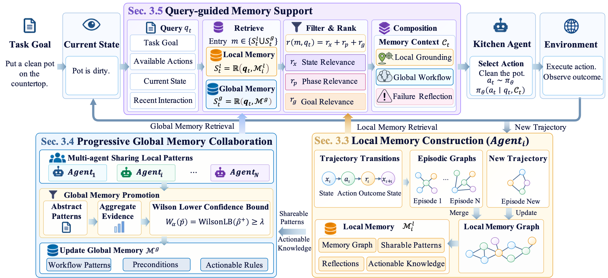
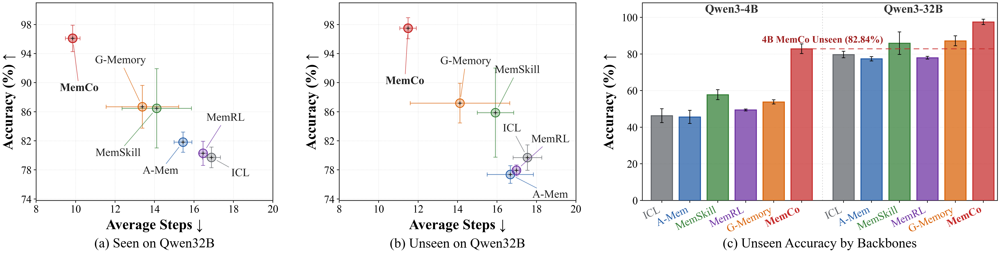

# MemCo: Memory-Centric Collaboration for Generalizing LLM Agents to Unseen Environments

This NVIDIA FLARE research example ports the latest MemCo implementation to the
released high-level Collab API. It preserves the local/global graph-memory method from
the [MemCo source artifact](https://github.com/SYannL/nvdamas/tree/main) while using
NVIDIA FLARE to coordinate domain clients, exchange memory artifacts, rebuild shared
global memory, and evaluate the resulting collaboration.

MemCo enables agents to reuse experience across environments without copying
environment-specific details into shared memory. It maintains a local graph for
grounded interaction experience and a global graph for transferable workflows and
rules. Local candidates are abstracted, aggregated across agents, and admitted to
global memory with a one-sided Wilson lower confidence bound. At each decision step,
MemCo retrieves from both memory scopes and adaptively composes local grounding,
global workflow guidance, and failure reflection.



## Publication Status

This research contribution is currently unpublished. Paper and citation information
will be added when they become available.

## Headline Results



The source artifact reports the following results for the submitted MemCo method:

- Qwen3-32B reaches 96.62% seen and 97.46% unseen ALFWorld accuracy, with 9.71 and
  11.23 average environment steps. Against G-Memory, this is an improvement of 9.93
  and 10.27 percentage points with shorter trajectories.
- Qwen3-4B reaches 82.84% unseen ALFWorld accuracy, exceeding the strongest
  same-backbone baseline by 25.10 percentage points.
- Across FEVER, PDDL, and the seen/unseen ALFWorld evaluations in the main table,
  MemCo obtains the highest accuracy in 10 of 12 settings and the fewest interaction
  steps in 9 of 12 settings.
- Wilson promotion reduces the reported global memory from 736 to 426 records
  relative to empirical-rate promotion. Adaptive composition retrieves 1.70 memories
  per decision, compared with 9.99 for fixed L5+G5 concatenation, while improving
  unseen accuracy by 16.07 percentage points.

These are paper-artifact results rather than precomputed outputs bundled with this
NVIDIA FLARE example. Exact values from a new run depend on the model endpoint,
benchmark assets, task order, and runtime configuration.

## Method Overview

MemCo follows a three-stage memory lifecycle:

1. **Local memory construction.** Each completed episode is converted into a graph
   of states, actions, outcomes, and temporal relations. Local memory retains concrete
   environment context and derives reusable patterns, actionable rules, and failure
   reflections.
2. **Progressive global collaboration.** Candidate patterns are converted to
   role-level forms, merged only when their structured keys match, and assigned one
   supporting or contradicting verdict per episode. Given supporting count `n+`,
   contradicting count `n-`, and `s = n+ + n-`, promotion uses the one-sided Wilson
   lower confidence bound with `z = Phi^-1(1-alpha)`. An eligible candidate is
   promoted when its lower bound is at least `lambda`.
3. **Query-guided memory support.** Local and global entries are ranked using state,
   phase, and goal relevance. Selected entries are filtered against the current state
   and available actions, then rendered as grounding, workflow, and reflection
   sections for next-action prediction.

The canonical configuration uses `alpha=0.05`, `lambda=0.35`, local retrieval limit
`k_l=5`, global retrieval limit `k_g=5`, and retrieval weights `1,1,1`.

## NVIDIA FLARE Collaboration

Each experiment runs one benchmark family and assigns its domains to NVIDIA FLARE
clients:

- PDDL: `gripper`, `blockworld`, `barman`, and `tyreworld`.
- FEVER: `A_film_tv` and `B_music`.
- ALFWorld: `bathroom`, `bedroom`, `kitchen`, and `living`.

PDDL, FEVER, and ALFWorld are separate experiments. Training calls one client at a
time so each domain receives the cumulative global memory from preceding domains.
After training, the server reconstructs a final global snapshot from every local
memory artifact and distributes the frozen result to all clients for parallel
`local_plus_global` evaluation.

The implementation uses only the released high-level Collab API:

- `MemCoServer.run()` is declared with `@collab.main`.
- `MemCoClient.train()` and `MemCoClient.evaluate()` use `@collab.publish`.
- `CollabRecipe` binds the server and client objects and deploys their files.
- `collab.clients` performs sequential training calls and parallel evaluation calls.
- `collab.workspace` provides isolated server and client work directories.
- `SimEnv` runs the example locally.

The example does not directly instantiate NVIDIA FLARE controllers, executors,
tasks, shareables, or broadcast APIs. Collab handles method routing, serialization,
workspace access, client identity, parallel calls, and error propagation.

## Repository Layout

```text
research/memco/
|-- README.md                  # Method, setup, and reproduction instructions
|-- LICENSE.pddlgym            # License for the bundled PDDLGym subset
|-- requirements.txt           # Runtime dependencies
|-- job.py                     # MemCoServer, MemCoClient, recipe, and simulator entry
|-- configs/
|   |-- pddl.json              # PDDL Collab experiment
|   |-- fever.json             # FEVER Collab experiment
|   |-- alfworld.json          # ALFWorld Collab experiment
|   `-- datasets.json          # Expected dataset counts and hashes
|-- runtime/
|   |-- mas/                   # Multi-agent workflow and MemCo runtime integration
|   `-- tasks/                 # Environments, prompts, and task workflows
|-- src/memco/
|   |-- core/                  # Graph construction, promotion, retrieval, serialization
|   `-- domains/               # Dataset loading and normalization
|-- scripts/
|   |-- run_domain.py          # Per-client benchmark worker
|   |-- validate_datasets.py   # Dataset validation
|   |-- check_parity.py        # Memory artifact comparison
|   `-- check_global_parity.py # Ordered local-to-global comparison
`-- tests/                     # Collab, aggregation, replay, and promotion tests
```

The client runtime keeps a vendored `memco_backend` under
`runtime/mas/memory/mas_memory/` so the original multi-agent execution path remains
intact. The framework-independent copy under `src/memco/core/` is used by the server
to aggregate client payloads without importing the benchmark runtime.

## Environment

Python 3.11 is recommended. Install NVIDIA FLARE from the current checkout and then
install the MemCo dependencies:

```bash
conda create -n memco python=3.11 -y
conda activate memco
python -m pip install --upgrade pip setuptools wheel

git clone https://github.com/NVIDIA/NVFlare.git
cd NVFlare
python -m pip install -e .
python -m pip install -r research/memco/requirements.txt
python -m nltk.downloader punkt punkt_tab
```

Never place API credentials in source files. Export the endpoint and key in the
shell:

```bash
export OPENAI_API_BASE="https://your-openai-compatible-endpoint/v1"
export OPENAI_API_KEY="your-key"
```

The default model is `gpt-4o-mini`. Override `model` in the selected JSON
configuration when using another OpenAI-compatible model endpoint. The first live run
also downloads the `sentence-transformers/all-MiniLM-L6-v2` embedding model.

## Benchmark Setup

Download the prepared MemCo partitions from the [MemCo data folder on Google Drive][memco-data]
and place them under a local data root:

[memco-data]: https://drive.google.com/drive/folders/1kulJADU3iVZGkIzmYqkr25uYu2TaZmlV?usp=share_link

```text
<data-root>/
`-- data/
    |-- pddl/
    |   |-- pddl_domain_gripper.jsonl
    |   |-- pddl_domain_blockworld.jsonl
    |   |-- pddl_domain_barman.jsonl
    |   |-- pddl_domain_tyreworld.jsonl
    |   `-- test.jsonl
    |-- fever/
    |   |-- fever_ab_train_A_v3.jsonl
    |   |-- fever_ab_train_B_v3.jsonl
    |   `-- fever_ab_test_v3.jsonl
    `-- alfworld/
        |-- collab_subsets/v3_s/
        `-- alfworld_official_042/json_2.1.1/
```

### ALFWorld

ALFWorld uses four room domains and evaluates the official `valid_seen` and
`valid_unseen` splits. In addition to the prepared collaboration subsets, it requires
the official `json_2.1.1` game assets.

### PDDL

PDDL uses four training partitions and a merged 60-task evaluation set. The required
PDDLGym subset is bundled under `runtime/tasks/envs/pddl_env/pddlgym/`.

### FEVER

FEVER uses Film/TV and Music training partitions and a balanced 60-task evaluation
set. Evaluation requires Wikipedia access or a stable `FEVER_WIKI_CACHE` file.

Validate the files against `configs/datasets.json` before running an experiment:

```bash
python research/memco/scripts/validate_datasets.py \
  --data-root /path/to/data-root \
  --family all
```

Replace `all` with `pddl`, `fever`, or `alfworld` to validate one family. Do not
replace `data/pddl/test.jsonl` with `data/pddl/pddl_ab_test.jsonl`; the latter does not
match the canonical evaluation set.

## Running the Collab Experiments

Run commands from the NVIDIA FLARE repository root.

### PDDL

```bash
PYTHONPATH=. python research/memco/job.py \
  --config research/memco/configs/pddl.json \
  --data-root /path/to/data-root \
  --workspace /tmp/nvflare/collab_simulation
```

### FEVER

```bash
PYTHONPATH=. python research/memco/job.py \
  --config research/memco/configs/fever.json \
  --data-root /path/to/data-root \
  --workspace /tmp/nvflare/collab_simulation
```

### ALFWorld

```bash
PYTHONPATH=. python research/memco/job.py \
  --config research/memco/configs/alfworld.json \
  --data-root /path/to/data-root \
  --alfworld-game-root /path/to/data-root/data/alfworld/alfworld_official_042/json_2.1.1 \
  --workspace /tmp/nvflare/collab_simulation
```

Each family configuration accepts these promotion settings:

- `promotion_policy`: `wilson`, `shadow`, or `legacy`.
- `wilson_alpha`: one-sided tail probability.
- `wilson_threshold`: required Wilson lower confidence bound, default `0.35`.
- `promotion_threshold`: legacy empirical score threshold.

`wilson` rebuilds the committed global snapshot solely from episode-level evidence.
Starting from an empty snapshot also removes records that no longer meet the lower
bound. `shadow` keeps legacy promotion active while writing the corresponding Wilson
result for comparison.

The paper-parameter controls
`NV_MEMCO_PAPER_EQ22_27_ALL_ONES=1` and
`NV_MEMCO_PAPER_A3_2_ACTIVATION_ALL_ONES=1` affect retrieval and routing weights, not
the Wilson acceptance rule.

## Outputs

The Collab simulator creates separate server and client work directories below the
selected workspace. The main client outputs are:

- `local_memory.json`: domain-local graph memory returned to the server.
- `shared_global/memco/global_memory.json`: global memory supplied to the client.
- `promotion_wilson.json`: evidence counts, lower bounds, decisions, and rejection
  reasons.
- `train_metrics.json`: training trajectory summary.
- `evaluate_metrics.json`: per-task rewards, completion flags, and aggregate metrics.
- Domain log directories containing task execution traces.

The server writes the reconstructed `global_memory.json` and
`metrics_by_client.json`, including the aggregate accuracy and average reward, under
its configured output directory.

## Validation

Run the MemCo unit tests without contacting a model endpoint:

```bash
cd research/memco
PYTHONPATH=src python -m unittest discover -s tests -v
```

The tests cover Collab recipe construction, known Wilson values, episode-level
evidence reduction, structural eligibility, serialization, legacy/shadow isolation,
snapshot rebuilding, domain loading, and deterministic LLM replay.

Check NVIDIA license headers from the repository root:

```bash
python ci/check_license_header.py research/memco
```

## Reproducibility and Legacy Parity

The migration changes orchestration rather than the MemCo graph algorithms. With
identical datasets, task order, prompts, model responses, seeds, and configuration,
the NVIDIA FLARE implementation is expected to match the source implementation at
four points:

1. Per-domain local memory JSON.
2. Promoted global memory JSON.
3. Per-task predictions, rewards, and completion flags.
4. Aggregate PDDL, FEVER, and ALFWorld metrics.

External retrieval must also remain fixed. In particular, FEVER comparisons should
use the same `FEVER_WIKI_CACHE` file.

Record deterministic model responses:

```bash
MEMCO_LLM_REPLAY_MODE=record \
MEMCO_LLM_REPLAY_PATH=/tmp/memco-responses.jsonl \
python research/memco/scripts/run_domain.py ...
```

Replay the same requests without API credentials or network access:

```bash
MEMCO_LLM_REPLAY_MODE=replay \
MEMCO_LLM_REPLAY_PATH=/tmp/memco-responses.jsonl \
python research/memco/scripts/run_domain.py ...
```

Every tape entry hashes the complete prepared request, and replay fails if prompts,
parameters, or call order differ. Use `scripts/check_parity.py` for artifact
comparison and `scripts/check_global_parity.py` for ordered local-to-global
transitions.

## Scope and Attribution

This NVIDIA FLARE example includes the MemCo implementation required for PDDL,
FEVER, and ALFWorld collaboration. It intentionally excludes ScienceWorld, BFCL,
PDDL2, generated memories, logs, model checkpoints, private credentials, and
machine-specific configuration.

The MemCo implementation is derived from the
[MemCo source artifact](https://github.com/SYannL/nvdamas/tree/main), which builds on
the public [GMemory](https://github.com/bingreeky/GMemory) research codebase and uses
the official ALFWorld, FEVER, and PDDLGym-derived environments.

## License

The MemCo code in this directory is released under the Apache License 2.0. Models,
datasets, and benchmark assets retain their respective licenses.

The PDDL runtime contains a minimized, compatibility-patched copy of PDDLGym 0.0.7,
copyright Tom Silver and Rohan Chitnis, distributed under the MIT License. See
`LICENSE.pddlgym`. ALFWorld is installed as an external dependency and retains its
upstream license; its benchmark data is not redistributed as part of this code.

## Citation

MemCo is currently unpublished. Citation information and a BibTeX entry will be added
when the paper becomes available.
